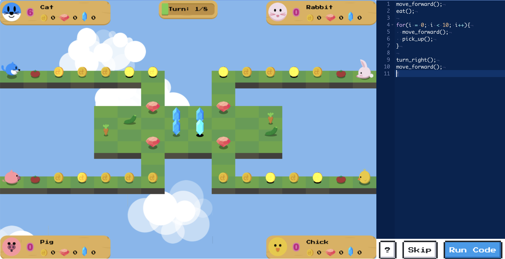

# Animal Coding

A turn-based multiplayer game that introduces basic programming concepts. Players control their animals with code, typed as JavaScript or built with blocks, to collect coins and gems.

**Players and educators:** visit the [Animal Coding website](https://withhawaii.github.io/animalcoding/) for how to play, classroom guidance, and a link to the game.



This README is for developers.

***

## Pages

The site is published with GitHub Pages from this repository.

| File | Purpose |
| :--- | :--- |
| `index.html` | Information for players and educators, with a link to the game |
| `game.html` | The game itself |
| `README.md` | Developer information, credits, and license |

## Running Locally

The game is plain HTML and JavaScript with no build step. Serve the folder with any static web server, for example:

```bash
python3 -m http.server 8000
```

Then open http://localhost:8000. Opening the HTML files directly from disk does not work because the game loads its maps and assets over HTTP.

## Tech Stack

- **[Phaser 3](https://phaser.io)** runs the game scenes, map, and animations.
- **[Ace](https://ace.c9.io)** is the text code editor.
- **[Blockly](https://developers.google.com/blockly)** is the block code editor. Block labels match the text-mode code.
- **[JS-Interpreter](https://github.com/NeilFraser/JS-Interpreter)** runs the player's code step by step in a sandbox, so each command can wait for its animation.

Libraries are loaded from CDNs, except JS-Interpreter, which is bundled in `lib/`.

## Project Structure

| Path | Contents |
| :--- | :--- |
| `js/constants.js` | Game constants, code snippets, and stage settings (`STAGE_CONFIG`) |
| `js/*_scene.js` | Phaser scenes: boot, title, main game, and results |
| `js/player.js`, `js/item.js`, `js/obstacle.js`, `js/dice.js` | Game objects |
| `js/editors.js` | `textEditor` (Ace) and `blockEditor` (Blockly), which share the same interface |
| `js/blocks.js` | Custom Blockly blocks and their JavaScript generators |
| `js/runner.js` | Runs the player's code and defines the game commands available to it |
| `js/ui.js` | Page UI: dialogs, configuration, buttons, and keyboard shortcuts |
| `lib/acorn_interpreter.js` | JS-Interpreter |
| `maps/` | Stage maps made with [Tiled](https://www.mapeditor.org) |
| `audio/`, `images/` | Sounds, sprites, and textures |

## How Player Code Runs

1. The selected editor returns the player's code as JavaScript (`ui.codeEditor.getCode()`). In Blocks mode, Blockly generates the code, adding a `highlight_block()` call before each block.
2. `runner.init()` creates a JS-Interpreter with the game commands from `runner.api()`. Movement commands are async functions that resume the code when their animation finishes. Condition checks such as `path_ahead` are native functions that return immediately.
3. `runner.run()` steps through the code, highlights the running line or block, and records loops, conditionals, and functions for the stage bonuses.

## Adding a Stage

1. Create a map in Tiled and save it as `maps/<stage>.json`.
2. Add an entry to `STAGE_CONFIG` in `js/constants.js` with the map, turn limit, music, intro video, and the snippets (commands) allowed in that stage. The Blocks editor builds its toolbox from the same snippet list.
3. Add the stage to the **Stage** menu in the Config dialog in `game.html`.
4. If the stage has a coding bonus, add its condition to `checkBonus()` in `js/main_scene.js`. Commands limited to certain stages (such as `steal()`) are also checked in `runner.api()` in `js/runner.js`.

***

## Credits

This project is built with the following open-source libraries and third-party assets:

| Name | Author | Type | License / Terms |
| :--- | :--- | :--- | :--- |
| [Phaser](https://phaser.io) | Phaser Studio Inc. | Library (game engine) | MIT |
| [Ace](https://ace.c9.io) | Ajax.org B.V. | Library (code editor) | BSD-3-Clause |
| [Blockly](https://developers.google.com/blockly) | Google / Raspberry Pi Foundation | Library (block editor) | Apache-2.0 |
| [JS-Interpreter](https://github.com/NeilFraser/JS-Interpreter) | Neil Fraser | Library (runs player code) | Apache-2.0 |
| [Acorn](https://github.com/acornjs/acorn) | Marijn Haverbeke | Library (JavaScript parser, bundled with JS-Interpreter) | MIT |
| [NES.css](https://nostalgic-css.github.io/NES.css/) | B.C.Rikko | Library (UI components) | MIT |
| [Farm, Puzzle & Animals graphics pack](https://comigo.itch.io/farm-puzzle-animals) | [CoMiGo](https://comigo.itch.io/) | Graphics | CC0 (Public Domain) |
| Platformer Autumn Game Tileset | [CraftPix.net](https://craftpix.net) | Graphics | [CraftPix Free License](https://craftpix.net/file-licenses/) |
| [Springin' Sound Stock](https://www.springin.org/sound-stock/) | Shikumi Design Inc. | Audio | [Springin' Sound Stock Terms of Use](https://www.springin.org/sound-stock/guideline/) |
| [TK's Free Sound FX](https://taira-komori.net/freesounden.html) | Taira Komori | Audio | Free sound effects |
| [8BITSOUNDS](https://sounds.udonko.net/) | UDONKONET | Audio | Free for commercial and non-commercial use |
| [Press Start 2P](https://fonts.google.com/specimen/Press+Start+2P) | CodeMan38 | Font | OFL-1.1 |

These libraries and assets remain the property of their respective owners and are not covered by this project's CC BY-NC-SA license.

***

## License

This project is licensed under the terms of the [CC BY-NC-SA (Attribution-NonCommercial-ShareAlike) 4.0 International License](https://creativecommons.org/licenses/by-nc-sa/4.0/).

If you are interested in using this project for commercial purposes, please contact [info@thinkology.ac](mailto:info@thinkology.ac) to discuss commercial licensing options.

© 2024-26 Thinkology LLC.